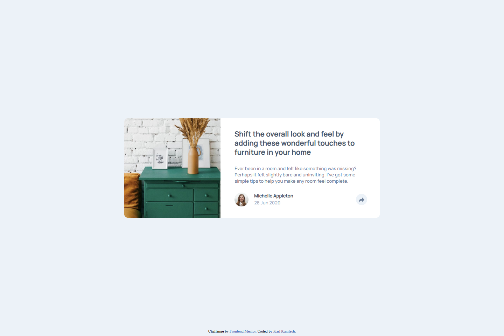
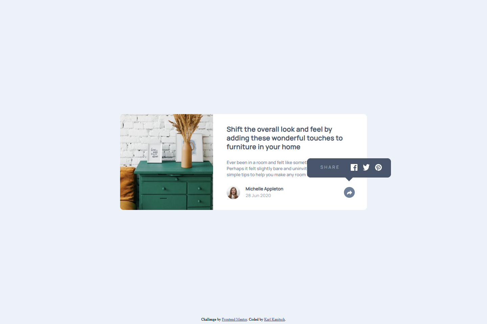
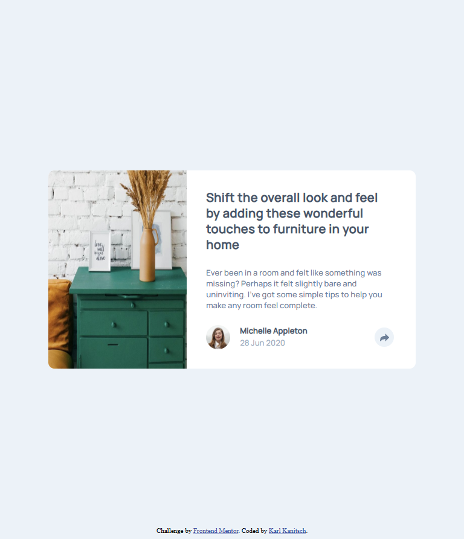
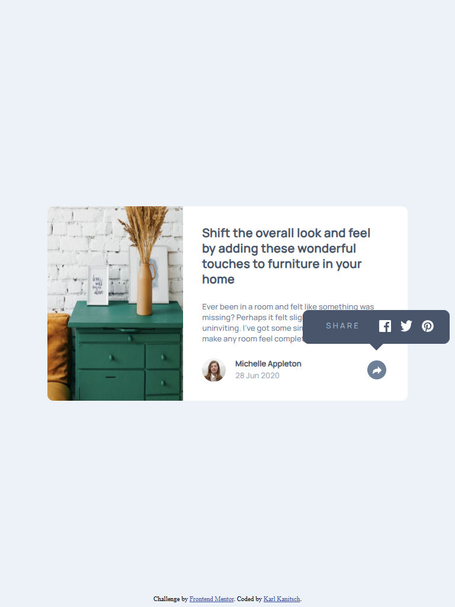
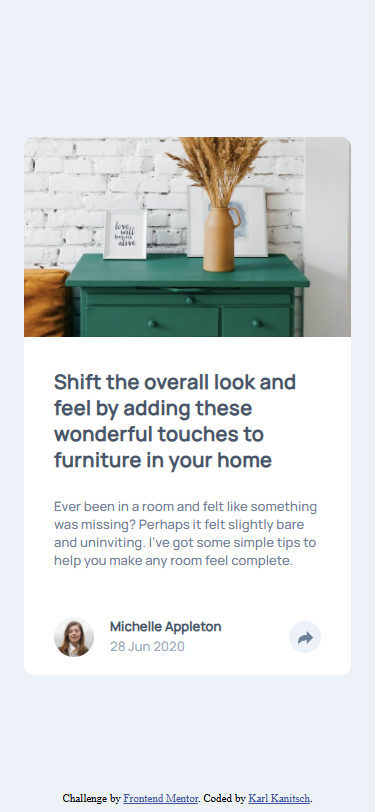

# Frontend Mentor - Article preview component solution

This is a solution to the [Article preview component challenge on Frontend Mentor](https://www.frontendmentor.io/challenges/article-preview-component-dYBN_pYFT). Frontend Mentor challenges help you improve your coding skills by building realistic projects. 

## Table of contents

- [Frontend Mentor - Article preview component solution](#frontend-mentor---article-preview-component-solution)
	- [Table of contents](#table-of-contents)
	- [Overview](#overview)
		- [The challenge](#the-challenge)
		- [Screenshot](#screenshot)
		- [Links](#links)
	- [My process](#my-process)
		- [Built with](#built-with)
		- [What I learned](#what-i-learned)
		- [Continued development](#continued-development)
		- [Useful resources](#useful-resources)
	- [Author](#author)

## Overview
This challenge was to build an article preview card with a share button that opens a panel of social links. The social sharing functionality itself is not implemented, but the button toggles the panel’s visibility.

The layout also needs to be responsive, including both the article preview card and the share panel’s layout and positioning. Button colors need to change to reflect active states, and the buttons must be keyboard-accessible.

### The challenge

Users should be able to:

- View the optimal layout for the component depending on their device's screen size
- See the social media share links when they click the share icon

### Screenshot

- Desktop View 
- Desktop View with Share Panel Open 
- Tablet View  
  
- Tablet View with Share Panel Open
  
- Mobile View  
  
- Mobile View  
  

### Links

- Solution URL: [https://github.com/kkanit22/FEM-3-1-article-preview-component](https://github.com/kkanit22/FEM-3-1-article-preview-component)
- Live Site URL: [https://kkanit22.github.io/FEM-3-1-article-preview-component/](https://kkanit22.github.io/FEM-3-1-article-preview-component/)

## My process

### Built with

- Semantic HTML5 markup
- CSS custom properties
- Flexbox
- CSS Grid
- Mobile-first workflow

### What I learned
Surprisingly, for a JavaScript-based challenge, I found the JavaScript quite simple—mostly a refresher. The responsive layout and changes to the shape and styling of components took the most time.

The main thing I learned from this build was how to use the CSS clip-path property to shape an element. I remember using border hacks to create triangles in the past, so clip-path felt like a clean, easy alternative and a welcome change.

### Continued development

Mostly, I look forward to building more functionality with JavaScript in future projects.

### Useful resources

- [clip-path CSS property](https://developer.mozilla.org/en-US/docs/Web/CSS/Reference/Properties/clip-path) - This provided the basis for using clip-path and includes other applications of this property.
- [polygon() CSS function](https://developer.mozilla.org/en-US/docs/Web/CSS/Reference/Values/basic-shape/polygon) - This is the function I used to build the triangle at the bottom of the share-panel and this article describes this and more interesting examples.

## Author

- Frontend Mentor - [@kkanit22](https://www.frontendmentor.io/profile/kkanit22)
